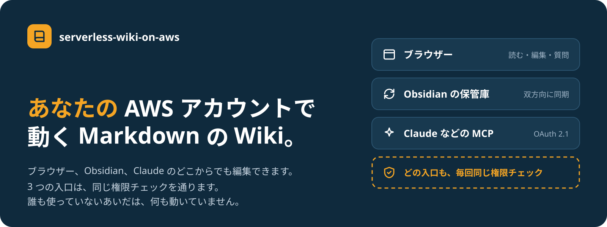
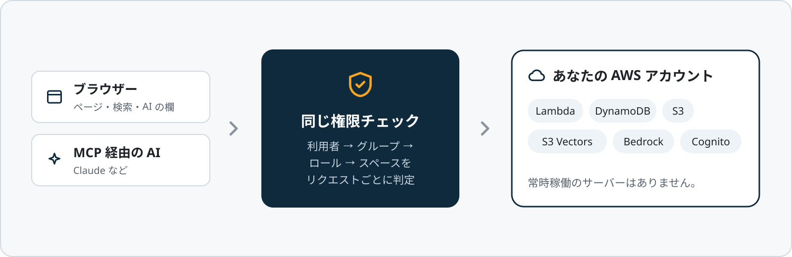
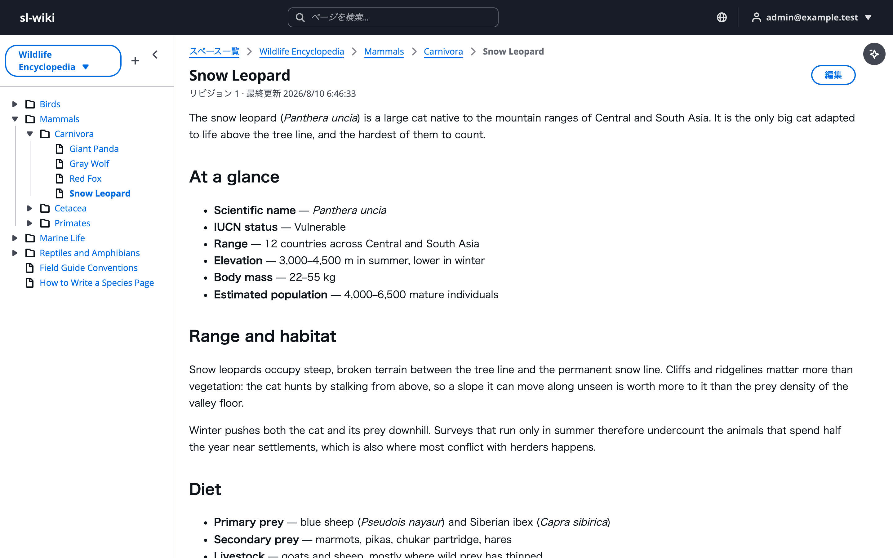
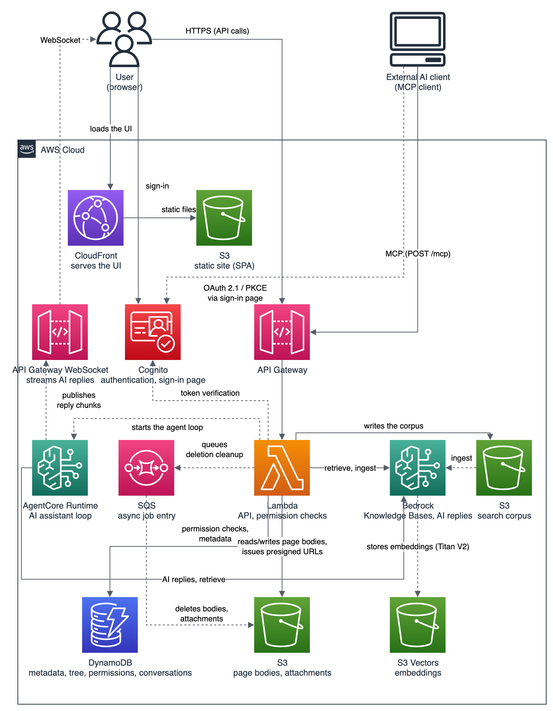
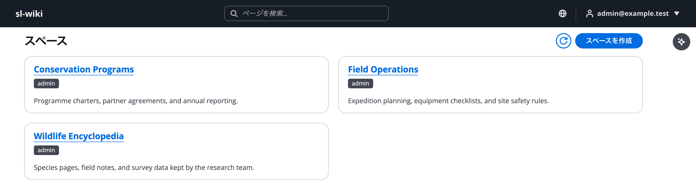
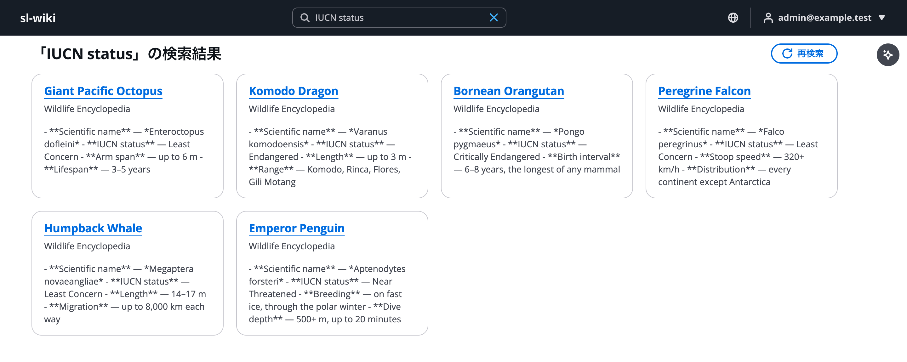
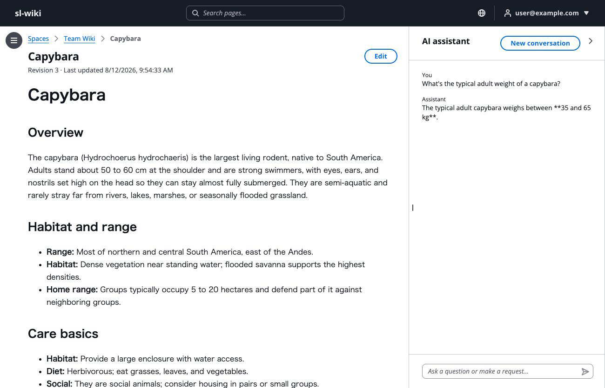
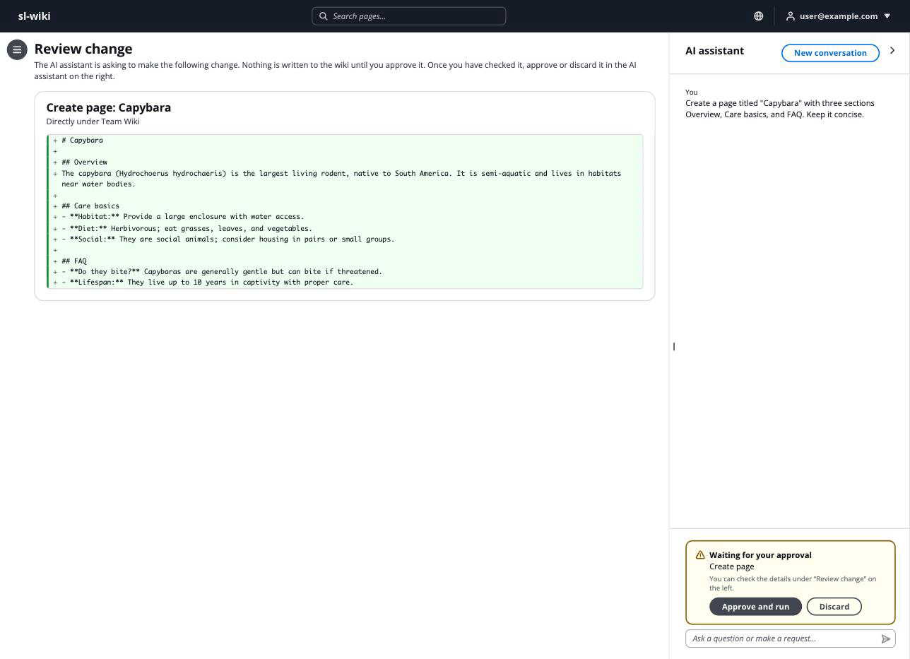
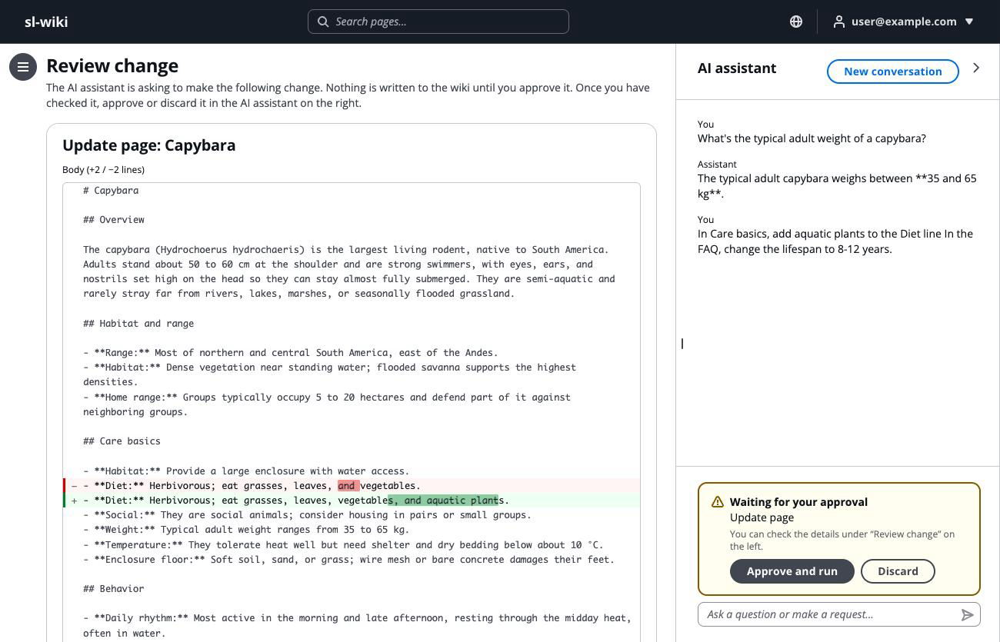

<p align="center">
  
</p>

<p align="center">
  <a href="LICENSE"></a>
  
  
  
  
  
</p>

<p align="center">
  <a href="#手元で試す">手元で試す</a> ·
  <a href="#できること">できること</a> ·
  <a href="#しくみ">しくみ</a> ·
  <a href="#aws-へデプロイする">デプロイ</a> ·
  <a href="#詳しい情報">詳しい情報</a> ·
  <a href="README.md">English</a> | <b>日本語</b>
</p>

## しくみ



ブラウザーの画面、Amazon Bedrock の AI アシスタント、MCP（Model Context Protocol、AI クライアントとツールを接続する標準プロトコル）のクライアント、Obsidian（ローカルの Markdown ノートアプリ）の同期プラグインは、どれも同じページを読み書きし、API 層がリクエストごとに行う同じ権限判定を通ります。
動作もデータの保管も運用者の AWS アカウントの中で完結し、常時稼働で常時課金されるリソースはありません。
デプロイするのは Lambda、API Gateway、DynamoDB、S3、S3 Vectors、CloudFront、Cognito、SQS、Bedrock です。Bedrock には、AI アシスタントを動かす Bedrock AgentCore Runtime を含みます。

すべてのサービスと矢印を描いた構成図は、[詳しい情報](#詳しい情報)にあります。

## できること

<table>
<tr>
<td width="33%" valign="top">
<br>
<b>Obsidian と双方向に同期</b><br>
スペースが保管庫のフォルダーになります。ノート、フォルダー、貼り付けた画像が両方向に行き来します。
</td>
<td width="33%" valign="top">
<br>
<b>書き換える前に聞く AI</b><br>
Bedrock の AI アシスタントが Wiki を検索して答え、変更は差分で見せます。承認するまで書き込みません。
</td>
<td width="33%" valign="top">
<br>
<b>意味でも語でも探せる検索</b><br>
S3 Vectors のハイブリッド検索。1 回の問い合わせで 1 つの順位を返し、抜粋とサジェストも出ます。
</td>
</tr>
<tr>
<td width="33%" valign="top">
<br>
<b>好きな方法でサインイン</b><br>
メールアドレスと認証アプリのコード、または OpenID Connect に対応した社内の認証基盤（IdP）。Microsoft Entra ID、Okta、OneLogin、Auth0、Keycloak など。
</td>
<td width="33%" valign="top">
<br>
<b>使わないあいだは止まっている</b><br>
Lambda、DynamoDB、S3。払うのはリクエスト、保存、AI のトークンの分だけです。
</td>
<td width="33%" valign="top">
<br>
<b>日本語と英語</b><br>
画面の言語はヘッダーで切り替えます。日本語の全文検索にも対応しています。
</td>
</tr>
</table>

ほかにも、次のものがそろっています。

- Markdown のページを、スペースごとのフォルダーとページの木構造で整理します
- IdP のグループをロールグループに対応づけると、サインインのたびに権限が IdP のグループに合わせて更新されます。パスワードでのサインインと併用できます
- `POST /mcp` の MCP サーバー。Cognito を認可サーバーとする OAuth 2.1 の認証で、Claude などの MCP クライアントからの接続を受け付けます
- スペース単位の権限を、API 層がリクエストごとに判定します。利用者が自分でサインアップすることはできず、運用者がアカウントを作ります。自分の権限を上げる API はありません
- 添付ファイルは presigned URL（署名付き URL、短時間だけ有効なリンク）で配信します。バケットはパブリックアクセスを全面ブロックします
- AI アシスタントの既定のモデルは Amazon Nova 2 Lite です。環境変数 `AI_MODEL_ID` で別の Bedrock のモデルに変更できます
- インフラは [AWS CDK Blocks](https://www.npmjs.com/package/aws-cdk-blocks)（Infrastructure-from-Code のフレームワーク）で定義します



*ページを読んでいるところです。ほかの画面は[詳しい情報](#詳しい情報)にあります。*

## 手元で試す

AWS アカウントは要りません。すべての Building Block が手元でモックとして動き、モックのデータは `.cdk-blocks/local/data/` に置かれます。
[Node.js 24](https://nodejs.org/) と [pnpm 11](https://pnpm.io/) が必要です（npm は使いません。`mise install` が `mise.toml` から両方を入れます）。

```bash
pnpm install
pnpm run local:add-user -- --email you@example.test   # 生成したパスワードを表示します
pnpm run dev                                          # http://localhost:3000 を開き、一度サインインします
# 開発サーバーを Ctrl-C で止めてから、自分を管理者にします
pnpm run seed-admin -- --local --email you@example.test
pnpm run dev
```

手元でも、デプロイ先と同じくサインアップは閉じています。そのため、先にアカウントを作ります。
`local:add-user` と `seed-admin` は、開発サーバーを止めてから実行します。データの保存先ファイルを開発サーバーが書き換えるためです。
`local:add-user` に `--password` を付けると、パスワードを自分で決められます。
最初のサインインで認証アプリの設定を求められます。手元のプールは 6 桁の数字なら何でも通します。
権限の判定は本番と同じに動くため、作ったばかりのアカウントには、`seed-admin` で管理者にするまでスペースが 1 つも見えません。
AI アシスタントだけは模擬モデルにつながっており、決まった文面を返します。

## AWS へデプロイする

AWS アカウント、[AWS CLI 2.32.0 以上](https://docs.aws.amazon.com/cli/latest/userguide/getting-started-install.html)、Amazon Nova 2 Lite と Titan Text Embeddings V2 に対する Bedrock のモデルアクセスが必要です。

```bash
aws login --profile <プロファイル名>
pnpm run deploy
```

初回のデプロイは 2 回実行され、2 回目は `pnpm run deploy` が自動で行います。
1 回目で作られる CloudFront のアドレスを、Lambda の環境変数に設定するためです。
アドレスが既にある場合、デプロイは 1 回で終わります。

<details>
<summary><b>最初のアカウントと管理者を作る</b></summary>

#### 最初のアカウントを作る

最初のアカウントは、運用者が Cognito のユーザープールに作ります。
パスワードは 12 文字以上で、大文字・小文字・数字・記号を各 1 つ以上含む必要があります。

```bash
# 名前がスタック ID で始まるプールが対象
aws cognito-idp list-user-pools --max-results 10 --profile <プロファイル名> --region <リージョン>

aws cognito-idp admin-create-user \
  --user-pool-id <ユーザープール ID> \
  --username you@example.com \
  --user-attributes Name=email,Value=you@example.com Name=email_verified,Value=true \
  --message-action SUPPRESS \
  --profile <プロファイル名> --region <リージョン>

# 初回サインインでパスワード変更を求められないよう、恒久的なパスワードとして設定する
aws cognito-idp admin-set-user-password \
  --user-pool-id <ユーザープール ID> \
  --username you@example.com \
  --password '<パスワード>' \
  --permanent \
  --profile <プロファイル名> --region <リージョン>
```

ユーザープールは MFA を必須にしており、方式は TOTP だけです。
そのため、運用者がブラウザーで最初にサインインすると、認証アプリの登録画面が出ます。
運用者は表示された QR コードを認証アプリで読み取り、そのアプリが出す 6 桁のコードを入力します。
2 回目以降のサインインは、コードの入力だけを求めます。

#### 最初の管理者を作る

運用者はブラウザで一度サインインします。
このサインインで利用者のプロフィールが作られ、次の手順で使う Cognito の `sub`（利用者の識別子）が確定します。
続いて権限テーブル（名前はスタック ID で始まり `-permissions` で終わります）に、自分を管理者として登録します。

```bash
aws dynamodb list-tables --profile <プロファイル名> --region <リージョン>
AWS_PROFILE=<プロファイル名> pnpm run seed-admin -- --table <テーブル名> --email you@example.com
```

`--email` で選べるのはパスワードのアカウントだけで、そのアドレスのアカウントが 1 つに限られるときだけです。
IdP 経由のアカウントは、アドレスでは選びません。そのアドレスは IdP が名乗らせたものにすぎないためです。
IdP の設定を誤って管理者が全員締め出されたときの復旧などで IdP 経由のアカウントを管理者にするときは、Cognito のコンソールでそのユーザー（ユーザー名は `<Cognito 登録名>_<IdP 側の sub>`）が本人であることを確かめ、アドレスの代わりに `--sub <sub>` を渡します。
スクリプトは書き込む前に、対象のアドレスとサインインの経路を表示します。アドレスだけでは対象が 1 つに決まらないときは、候補を並べて止まります。

2 人目以降の管理者は、最初の管理者が管理画面から追加します。

</details>

<details>
<summary><b>IdP でサインインできるようにする（OIDC）</b></summary>

OIDC に対応した IdP なら、設定する内容はどれも同じです。
Microsoft Entra ID の画面操作は付録 [`guides/sso-entra-id.ja.md`](guides/sso-entra-id.ja.md) に、OneLogin は付録 [`guides/sso-onelogin.ja.md`](guides/sso-onelogin.ja.md) にあります。
IdP は Wiki 自身の Cognito ユーザープールに登録するため、連携の利用者もプールのユーザーになります。識別子は全員がプールの `sub` に統一され、連携の利用者も MCP と同期 API をそのまま使えます。

IdP の設定は、リポジトリルートの設定ファイル `sso.config.json` に書きます。ファイルが無ければ SSO は構成されず、サインイン画面にはパスワードの欄だけが表示されます。ファイルにはテナント ID とクライアント ID が載ります（クライアントシークレットは載せません）。コミットするのは非公開のクローンだけにしてください。

1. IdP 側に OIDC の Web アプリケーションを 1 つ作ります。リダイレクト URI は `https://<プールのサインインドメイン>/oauth2/idpresponse`（スタック出力 `SsoIdpRedirectUri` の値。SSO 有効化前なら `McpSignInDomain` に `/oauth2/idpresponse` を付けた値と同じです）、スコープは `openid email profile`、付与タイプは認可コードです
2. **利用者のグループを ID トークンのクレーム（トークンに載る属性）へ載せる設定を、IdP 側で有効にし、送るのは「このアプリに割り当てたグループだけ」にします。** クレームは既定で送らない IdP が多く、忘れると誰にも権限が付きません。絞り忘れると、グループの多い利用者ではグループを受け取る Cognito の属性（最大 2048 文字）が溢れ、やはり権限が付きません
3. IdP のクライアントシークレットを、デプロイより先に Secrets Manager へ入れます（デプロイ時に CloudFormation が読みます。シークレット 1 件あたり月 0.40 USD かかります）

   ```bash
   aws secretsmanager create-secret --name '<スタック名>-sl-wiki-sso-idp-client-secret' \
     --secret-string '<クライアントシークレット>'
   ```

4. `sso.config.json` を書いてデプロイします。SSO を初めて有効にするデプロイは、自動で 2 回実行されます

   ```json
   {
     "idps": [
       {
         "name": "sso",
         "issuerUrl": "https://<IdP の発行者 URL>",
         "clientId": "<IdP のクライアント ID>"
       }
     ]
   }
   ```

   エントリの任意フィールドは `label`（サインインボタンの表示名）、`groupsClaim`（既定 `groups`）、`scopes`（既定 `openid email profile`。Okta と OneLogin はグループを載せるのに `groups` を足します）、`secretName`（シークレットを既定と別の名前で作ったとき）、`registrationName`（Cognito がこの IdP を呼ぶ名前。連携ユーザー名の接頭辞になるため、あとから変えると別のアカウントとして扱われます）です。独自ドメインを使うときは、トップレベルの `callbackOrigins` 配列で戻り先のオリジンを書きます。

5. 管理画面の「ロールグループ」を開き、「外部 IdP のグループとの対応」に、どの IdP かと、クレームに載るグループの識別子（Entra ならグループの表示名ではなくオブジェクト ID、OneLogin ならロールの名前）を行で入れます

IdP は複数登録できます。2 件目以降は `idps` 配列にエントリを足します。配列の並び順がサインインボタンの並び順になり、`name` が IdP を識別します。プールには IdP ごとに登録とクライアントの組ができ、サインイン画面には IdP ごとのボタンが並びます。

ファイルからエントリを消してデプロイすると、デプロイスクリプトがプールの登録済み IdP と突き合わせ、エラーで停止します（編集ミスで連携サインインが壊れないようにするためです）。削除する意図があるときは `SSO_REMOVE=<名前>` を付けて実行します（改名は旧名の削除として扱います。全削除は `SSO_REMOVE=true` です）。

> **フェデレーションの利用者の権限は、IdP 側で調整してください。**
> サインインのたびに、Wiki はその利用者のロールグループを IdP のクレームどおりに書き換えます（無いものは消します）。
> そのため Wiki の管理画面から変えても、次のサインインで消えます。画面もその割り当ては読み取り専用で見せます。
> IdP 側でグループから外しても、Wiki に反映されるのは次回のサインイン時です。すぐに止めたいときは、IdP 側でその利用者のサインインを止めてください。
> 一方、Wiki 側で対応づけそのものを消すと、対応づけられていた利用者全員からその場で権限が外れます。

パスワードでのサインインは無効になりません。IdP の設定を誤ったときに、設定を直しに入る手段を残すためです。
プールの MFA（多要素認証）必須の設定はパスワードのアカウントにだけ効くので、連携の利用者の MFA は IdP 側で設定します（Entra なら条件付きアクセス）。
同じメールアドレスでも、パスワードのアカウントと IdP のアカウントは別ユーザーで、権限も別々に付きます。

SAML には対応しません。

</details>

<details>
<summary><b>Claude などの MCP クライアントに登録する</b></summary>

`.mcp.json.example` を `.mcp.json` に写し、CloudFront のドメインと、スタック出力 `McpClientId` の値を埋めます。

```bash
aws cloudformation describe-stacks --stack-name <スタック名> --profile <プロファイル名> \
  --query 'Stacks[0].Outputs[?OutputKey==`McpClientId`].OutputValue' --output text
```

</details>

<details>
<summary><b>Obsidian と同期する</b></summary>

同梱のプラグイン `clients/obsidian/` が、Obsidian の保管庫と、利用者が読めるスペースを同期します。
両者が食い違ったときは Wiki の内容を優先し、プラグインが手元のファイルを退避してから Wiki の内容で上書きします。
導入と利用の手順は [clients/obsidian/README.ja.md](clients/obsidian/README.ja.md) にあります。

</details>

<details>
<summary><b>設定（環境変数）</b></summary>

| 環境変数 | 既定 | 役割 |
|---|---|---|
| `CORS_ALLOWED_ORIGINS` | `pnpm run deploy` がスタックの出力から読みます | S3 のバケットが presigned URL の要求を受け付けるオリジンの一覧（カンマ区切り）です。一致するものが無いと、ブラウザからの添付ファイルの操作が失敗します。カスタムドメインを使っているときと、配信オリジンが複数あるときは、明示的に指定します。ワイルドカードは受け付けません |
| `MCP_PUBLIC_ORIGIN` | `pnpm run deploy` がスタックの出力から読みます | MCP の OAuth メタデータが公示するオリジンです。カスタムドメインのときは明示的に指定します |
| `AI_MODEL_ID` | `global.amazon.nova-2-lite-v1:0` | AI アシスタントが呼ぶ Bedrock のモデルです。既定は Amazon Nova 2 Lite の Global 推論プロファイル（リクエストを対応リージョンへ振り分ける定義）です。`jp.amazon.nova-2-lite-v1:0` は推論を日本国内のリージョンに限定し、`global.anthropic.claude-sonnet-4-6` と `global.anthropic.claude-sonnet-5` はツール選択の精度が上がり料金も上がります。どのモデルも、Bedrock 側でモデルアクセスを先に有効にする必要があります（この環境変数はアクセス権を与えません）。未設定や空文字のときはエラーにならず、既定値が使われます |

</details>

<details>
<summary><b>リージョン</b></summary>

CloudFormation のスタックは、AWS CLI のプロファイルに設定されたリージョンへデプロイされます。動作を確認済みなのは `ap-northeast-1`（東京）です。どのリージョンでも、S3 Vectors、Bedrock AgentCore Runtime、上の 2 つの Bedrock のモデルが使える必要があります

</details>

<details>
<summary><b>sandbox と撤去</b></summary>

#### sandbox

`pnpm run sandbox` は、バックエンドを AWS に置き、フロントエンドを手元で動かします。
フロントエンドのオリジンは自動では設定されないため、環境変数で指定します。

```bash
CORS_ALLOWED_ORIGINS=http://localhost:3000 pnpm run sandbox
```

#### 撤去する

```bash
pnpm run sandbox:destroy   # sandbox のスタックを、データごと消します
pnpm run destroy           # デプロイしたスタックを消します
```

`pnpm run sandbox:destroy` は、テーブルもバケットもスタックと一緒に消します。
`pnpm run destroy` は、DynamoDB のテーブル、本文と添付のバケット、検索用のベクトルバケットを残す設定です。
残っているあいだは保存の料金がかかります。消すときは運用者が手動で削除します。

</details>

## 詳しい情報

<details>
<summary><b>構成図（全体）</b></summary>



*実線の矢印は同期のリクエスト経路を、破線の矢印は非同期の処理の流れを表します。*

</details>

<details>
<summary><b>ほかの画面</b></summary>



*スペースの一覧です。カードのバッジは、サインイン中のアカウントがそのスペースに持つ権限を表します。*



*検索の結果です。*



*AI アシスタントに質問したところです。*



*AI アシスタントにページの作成を頼んだところです。利用者が承認するまで、AI アシスタントは Wiki に書き込みません。*



*既存ページの編集は、承認の前に差分で確かめられます。*

</details>

<details>
<summary><b>ディレクトリ構成</b></summary>

```
serverless-wiki-on-aws/
├── cdk-blocks/           # バックエンド
│   ├── index.cdk.ts      # CDK アプリ（Building Block の宣言は resources.ts）
│   ├── index.ts          # フロントエンドが呼ぶ API
│   ├── access.ts         # 権限判定
│   ├── wiki-ops.ts       # ページ、ツリー、検索の操作
│   ├── search-index.ts   # 検索の索引への書き込みとハイブリッド検索
│   ├── mcp.ts            # MCP サーバー（POST /mcp）
│   ├── ext.ts            # 同期クライアント向け API（POST /ext/*）
│   └── scripts/          # deploy、sandbox、seed-admin、destroy
├── src/                  # フロントエンド（React 19 + Vite + Cloudscape）
│   ├── app/              # ルーティング、プロバイダー、画面の外枠
│   ├── features/         # spaces、pages、search、assistant、auth、admin
│   ├── components/       # feature をまたいで使う UI 部品
│   └── lib/              # Markdown、差分、ルーター、TanStack Query、日英の辞書
├── clients/obsidian/     # Obsidian 同期プラグイン
├── test/                 # API 全体を通す E2E テストと、単体テスト
├── assets/               # この文書に載せる画面の画像、図、アイコン
└── README.md             # 英語版のこの文書
```

</details>

<details>
<summary><b>制約</b></summary>

- **語の一致は単語の単位で判定します。** S3 Vectors の日本語の解析器をそのまま使っているためです。語の途中（「マネコ」で「リビアヤマネコ」）や、長音の有無の違い（「サーバ」と「サーバー」）では一致しません。入力途中のサジェストも、語を打ち終えるまで出ません。
- **手元の開発サーバーでは、検索は部分一致の簡易版で動きます。** S3 Vectors に手元で動く代わりが無いためです。ハイブリッド検索の結果は sandbox で確かめます。
- **本文の中の生の HTML は描画しません。** Markdown は CommonMark（Markdown の標準仕様）に GFM（GitHub Flavored Markdown、GitHub 方言）の表・タスクリスト・取り消し線を足した範囲を描画し、1 つだけの改行も改行として扱いますが、本文に書いた HTML タグは解釈せず、文字のまま表示します。画像として埋め込めるのはそのページ自身の添付だけで、それ以外の画像はリンクとして表示します。検索結果の抜粋は Markdown を解釈せず、記法を記号のまま表示します。
- **最初のアカウントの作成には AWS CLI の操作が必要です。** デプロイ直後に、運用者が AWS CLI で Cognito にアカウントを作り、一度サインインしてから `pnpm run seed-admin` を実行します。
- **監査ログと、API のレートリミット（呼び出し回数の制限）はありません。**

</details>

## 参考

- [AWS CDK Blocks](https://github.com/aws/cdk-blocks)：このプロジェクトの実装基盤
- [Amazon S3 Vectors のハイブリッド検索](https://docs.aws.amazon.com/AmazonS3/latest/userguide/s3-vectors-hybrid-search.html)：検索の基盤
- [Model Context Protocol](https://modelcontextprotocol.io/)：`/mcp` エンドポイントのプロトコル
- [Cloudscape Design System](https://cloudscape.design/)：画面に使っている UI 部品のデザインシステム

## ライセンス

[MIT License](LICENSE)
