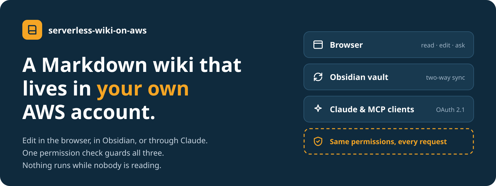
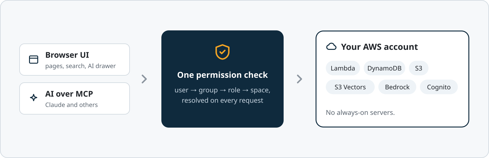
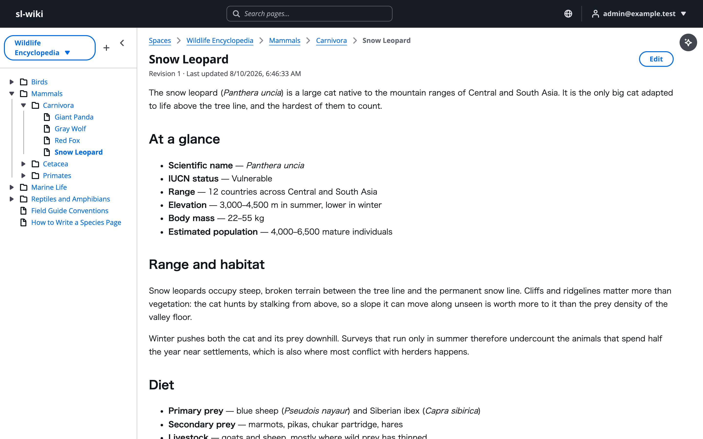
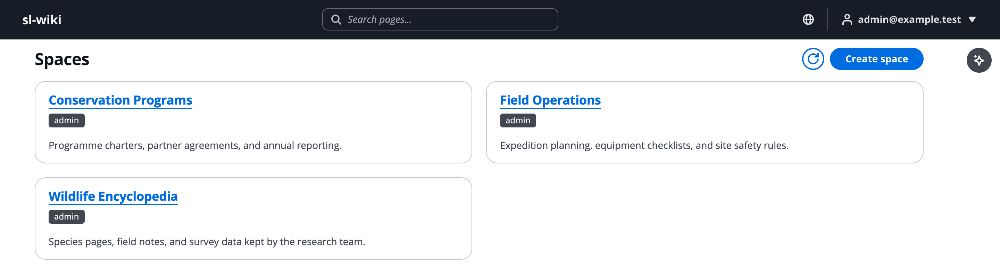
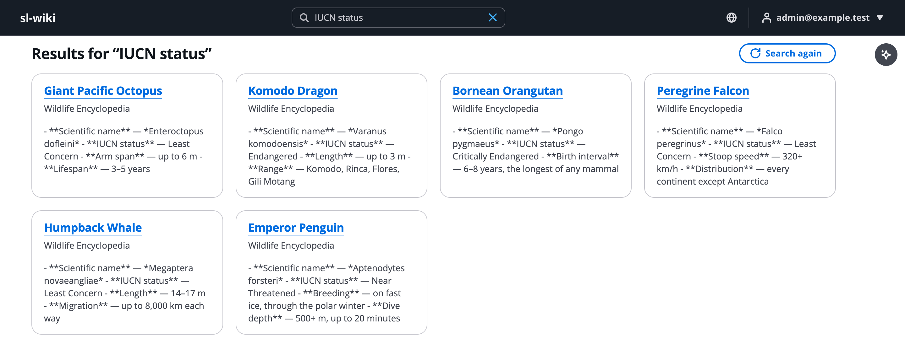
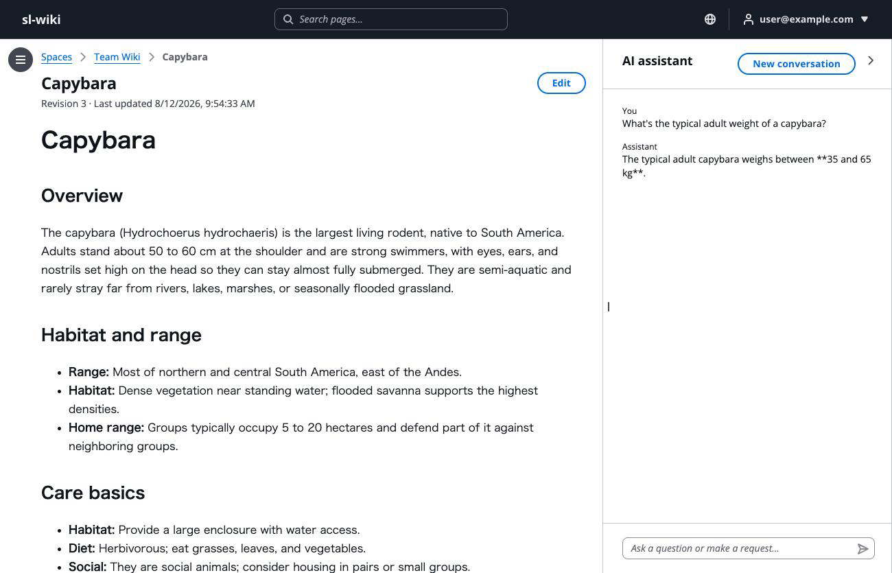
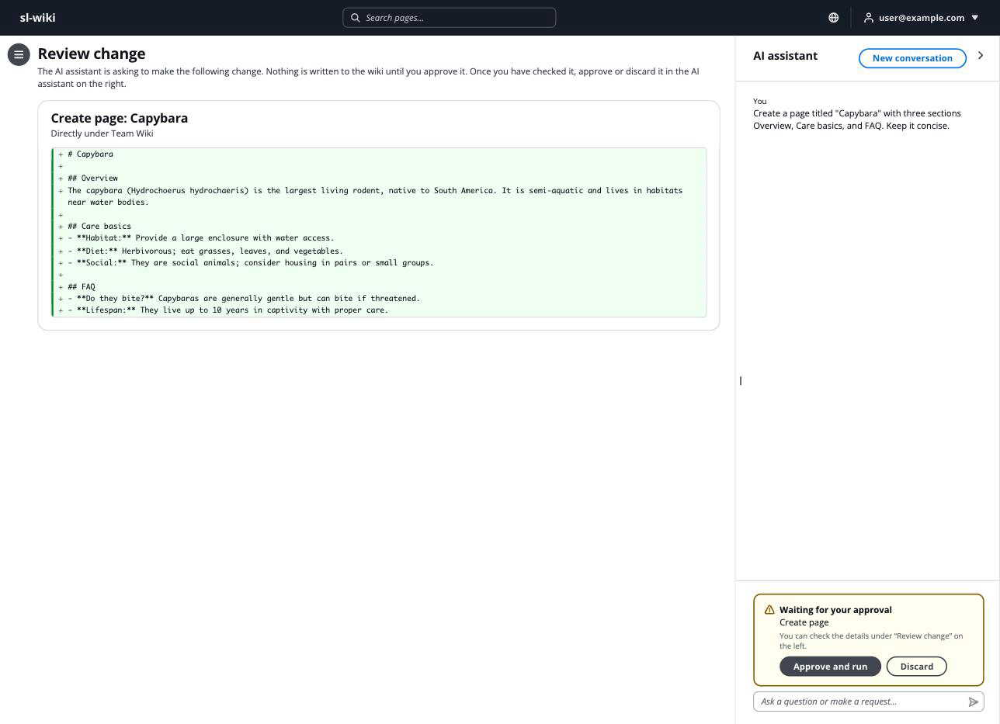
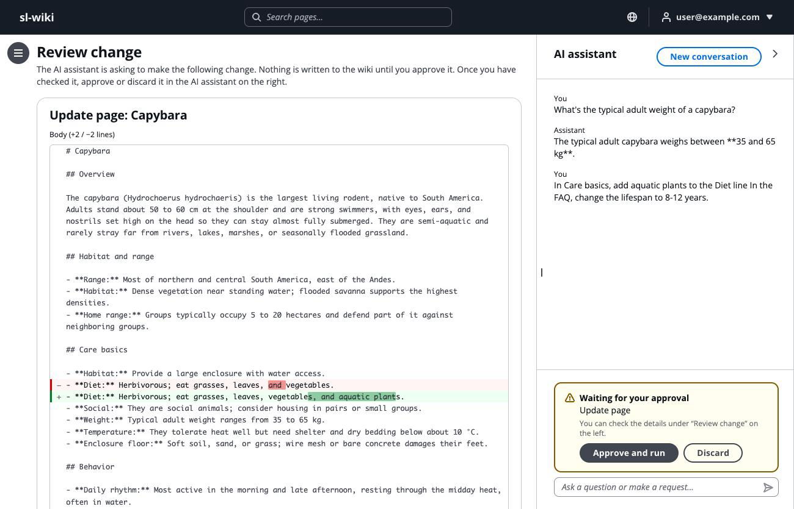

<p align="center">
  
</p>

<p align="center">
  <a href="LICENSE"></a>
  
  
  
  
  
</p>

<p align="center">
  <a href="#try-it-on-your-laptop">Try it locally</a> ·
  <a href="#what-you-get">Features</a> ·
  <a href="#how-it-fits-together">How it works</a> ·
  <a href="#deploy-to-aws">Deploy</a> ·
  <a href="#reference">Reference</a> ·
  <b>English</b> | <a href="README.ja.md">日本語</a>
</p>

## How it fits together



The browser UI, the Amazon Bedrock assistant, MCP clients, and the Obsidian sync plugin read and write the same pages through the same space permission check, resolved in the API layer on every request.
Everything runs and stores its data inside the operator's own AWS account, and there are no always-on, always-billing resources.
The deployed stack is Lambda, API Gateway, DynamoDB, S3, S3 Vectors, CloudFront, Cognito, SQS, and Bedrock, including a Bedrock AgentCore Runtime that runs the AI assistant.

The full diagram, with every service and arrow, is under [Reference](#reference).

## What you get

<table>
<tr>
<td width="33%" valign="top">
<br>
<b>Two-way Obsidian sync</b><br>
Each space becomes a folder in your vault. Notes, folders and pasted images travel both ways.
</td>
<td width="33%" valign="top">
<br>
<b>An AI that asks first</b><br>
The Bedrock assistant searches the wiki, answers from what it finds, and shows a diff. Nothing is written until you approve.
</td>
<td width="33%" valign="top">
<br>
<b>Search by meaning and by words</b><br>
S3 Vectors hybrid search: one query, one ranking, highlighted excerpts, and suggestions as you type.
</td>
</tr>
<tr>
<td width="33%" valign="top">
<br>
<b>Sign in your way</b><br>
Email with TOTP, or any OIDC provider: Microsoft Entra ID, Okta, OneLogin, Auth0, Keycloak.
</td>
<td width="33%" valign="top">
<br>
<b>Nothing runs while idle</b><br>
Lambda, DynamoDB and S3. You pay for requests, storage and AI tokens, not for waiting.
</td>
<td width="33%" valign="top">
<br>
<b>Japanese and English</b><br>
Switch the UI language from the header. Japanese full-text search is built in.
</td>
</tr>
</table>

Also in the box:

- Markdown pages arranged in a folder-and-page tree, one tree per space
- Map an identity provider's group to a role group, and permissions are updated to match the IdP's groups on every sign-in. Password sign-in keeps working alongside it
- An MCP (Model Context Protocol) server at `POST /mcp`, authenticated with OAuth 2.1 through Cognito, for Claude and other MCP clients
- Space-level permissions resolved in the API layer on every request. Sign-up is closed: an operator creates accounts, and no API raises anyone's own permissions
- Attachments delivered through presigned URLs; the bucket blocks all public access
- The assistant's default model is Amazon Nova 2 Lite; set `AI_MODEL_ID` to use another Bedrock model
- Infrastructure defined with [AWS CDK Blocks](https://www.npmjs.com/package/aws-cdk-blocks), an Infrastructure-from-Code framework



*Reading a page. More screens are under [Reference](#reference).*

## Try it on your laptop

No AWS account is needed. Every Building Block runs mocked on your machine, and the mock data lands in `.cdk-blocks/local/data/`.
You need [Node.js 24](https://nodejs.org/) and [pnpm 11](https://pnpm.io/) (npm is not supported; `mise install` picks up both from `mise.toml`).

```bash
pnpm install
pnpm run local:add-user -- --email you@example.test   # prints a generated password
pnpm run dev                                          # open http://localhost:3000 and sign in once
# stop the dev server with Ctrl-C, then make yourself an administrator
pnpm run seed-admin -- --local --email you@example.test
pnpm run dev
```

Sign-up is closed here too, as on a deployed stack, which is why you create the account first.
Run `local:add-user` and `seed-admin` with the dev server stopped, because it rewrites the local data files.
Add `--password` to `local:add-user` to choose the password yourself.
The first sign-in asks you to set up an authenticator app; the local pool accepts any 6 digits.
Permission checks work as in production, so a new account sees no spaces until `seed-admin` makes it an administrator.
Only the assistant differs: it talks to a mock model that replies with fixed text.

## Deploy to AWS

You need an AWS account, [AWS CLI 2.32.0+](https://docs.aws.amazon.com/cli/latest/userguide/getting-started-install.html), and Bedrock model access for Amazon Nova 2 Lite and Titan Text Embeddings V2.

```bash
aws login --profile <profile>
pnpm run deploy
```

The first deploy runs twice, and `pnpm run deploy` runs the second pass itself: it sets the CloudFront address created by the first pass into the Lambda's environment variables. Once the address exists, a deploy runs once.

<details>
<summary><b>Create the first account and administrator</b></summary>

#### The first account

Create the first account yourself in the Cognito user pool. The password has to be 12 characters or longer and carry an upper-case letter, a lower-case letter, a digit, and a symbol.

```bash
# The pool whose name starts with your stack id
aws cognito-idp list-user-pools --max-results 10 --profile <profile> --region <region>

aws cognito-idp admin-create-user \
  --user-pool-id <user-pool-id> \
  --username you@example.com \
  --user-attributes Name=email,Value=you@example.com Name=email_verified,Value=true \
  --message-action SUPPRESS \
  --profile <profile> --region <region>

# Set the password permanently, so the first sign-in is not a password-change challenge
aws cognito-idp admin-set-user-password \
  --user-pool-id <user-pool-id> \
  --username you@example.com \
  --password '<password>' \
  --permanent \
  --profile <profile> --region <region>
```

The pool requires MFA and offers TOTP as the only factor, so the first sign-in in the browser presents an enrolment challenge: scan the QR code with an authenticator app and enter the six-digit code it shows. Every later sign-in asks for a code.

#### The first administrator

Sign in once in the browser first. That sign-in creates your profile record and determines the Cognito `sub` (your user identifier) the next step uses. Then register yourself as an administrator in the permission table — its name starts with the stack id and ends in `-permissions`.

```bash
aws dynamodb list-tables --profile <profile> --region <region>
AWS_PROFILE=<profile> pnpm run seed-admin -- --table <table-name> --email you@example.com
```

`--email` chooses a password account, and only when exactly one has that address. A federated (IdP) account is never chosen by address, because its address is whatever its IdP asserted. To make one an administrator, for example to recover after an IdP misconfiguration locks every administrator out, confirm in the Cognito console that the user (named `<registration name>_<sub at the IdP>`) is the right person, then pass its `sub` in place of the address: `--sub <sub>`. The script prints the account's address and sign-in method before it writes anything, and stops with a list of candidates when the address does not settle which account is meant.

Every administrator after the first one is added by an administrator, from the admin screens.

</details>

<details>
<summary><b>Sign in with your identity provider (OIDC)</b></summary>

The settings are the same for every OIDC provider.
For Microsoft Entra ID, the appendix [`guides/sso-entra-id.md`](guides/sso-entra-id.md) walks through the actual screens; [`guides/sso-onelogin.md`](guides/sso-onelogin.md) does the same for OneLogin. The IdP is registered on the wiki's own Cognito user pool, so federated users become pool users too: everyone is identified by the pool's `sub`, and federated users can use MCP and the sync API as well.

The IdP entries live in a config file, `sso.config.json`, at the repository root. Without the file, SSO is not set up and the sign-in screen shows only the password form. The file carries your tenant and client IDs (never the client secret), so commit it to private clones only.

1. Create one OIDC web application at your IdP. Redirect URI `https://<pool sign-in domain>/oauth2/idpresponse` (the `SsoIdpRedirectUri` stack output; before SSO is enabled, `McpSignInDomain` + `/oauth2/idpresponse` is the same value), scopes `openid email profile`, authorization-code grant.
2. **Turn on the setting that puts the user's groups into the ID token as a claim**, and limit it to the groups assigned to this app. Most providers leave the claim off, and without it a sign-in succeeds but grants no permissions; without the limit, a user in many groups overflows the Cognito attribute that receives them (2048 characters) and also gets no permissions.
3. Put the IdP's client secret into Secrets Manager before deploying — CloudFormation reads it from there (one secret, $0.40/month while SSO is on):

   ```bash
   aws secretsmanager create-secret --name '<stack-name>-sl-wiki-sso-idp-client-secret' \
     --secret-string '<client secret>'
   ```

4. Write `sso.config.json` and deploy. The first SSO deploy runs a second pass by itself:

   ```json
   {
     "idps": [
       {
         "name": "sso",
         "issuerUrl": "https://<your issuer URL>",
         "clientId": "<your client id>"
       }
     ]
   }
   ```

   Optional entry fields: `label` (the sign-in button's text), `groupsClaim` (default `groups`), `scopes` (default `openid email profile` — Okta and OneLogin want `groups` added before they put groups in the token), `secretName` (when the secret is not under the default name), and `registrationName` (the name Cognito knows the IdP by; it prefixes federated usernames, so changing it later orphans those accounts). A top-level `callbackOrigins` array overrides the resolved origin when a custom domain sits in front.

5. In the admin screens, open a role group and fill in "Mapping to external IdP groups" with rows naming which IdP and the group's identifier as it appears in the claim (for Entra that is the group's object ID, not its display name; for OneLogin, the role's name).

More than one IdP can be registered: add entries to the `idps` array (the array order sets the button order; `name` identifies the IdP). The pool gets a registration and app client per IdP, and the sign-in screen draws one button per IdP.

Removing an entry from the file is guarded: the deploy script compares the file against the pool's registrations and stops if one would disappear, so an editing mistake cannot break federated sign-in. Confirm a deliberate removal with `SSO_REMOVE=<name>` (a rename counts as removing the old name), or `SSO_REMOVE=true` to remove them all.

> **Adjust a federated user's permissions at the identity provider.**
> Every sign-in rewrites that user's role groups to match the IdP's claims, removing any the claims no longer name. An edit made in the wiki's admin screens is undone by their next sign-in, which is why those screens show the assignment read-only.
> Removing someone from a group at the IdP reaches the wiki at their next sign-in, so to cut them off immediately, stop their sign-in at the IdP. Clearing the mapping in the wiki, by contrast, disconnects everyone on it at once.

Password sign-in stays enabled, so a misconfigured IdP does not lock out the person who has to fix it. The pool's MFA requirement applies to password accounts only; require MFA for federated users at the IdP (conditional access, in Entra's terms). A password account and a federated account with the same email address are separate users with separate permissions.

SAML is not supported.

</details>

<details>
<summary><b>Connect Claude and other MCP clients</b></summary>

Copy `.mcp.json.example` to `.mcp.json` and fill in the CloudFront domain and the `McpClientId` stack output.

```bash
aws cloudformation describe-stacks --stack-name <stack-name> --profile <profile> \
  --query 'Stacks[0].Outputs[?OutputKey==`McpClientId`].OutputValue' --output text
```

</details>

<details>
<summary><b>Set up Obsidian sync</b></summary>

The bundled plugin in `clients/obsidian/` syncs an Obsidian vault with the spaces you can read. When the two sides disagree, the wiki's version takes precedence: the plugin backs up your local copy, then overwrites it with the wiki's version. Setup and usage are in [clients/obsidian/README.md](clients/obsidian/README.md).

</details>

<details>
<summary><b>Configuration variables</b></summary>

| Variable | Default | Purpose |
|---|---|---|
| `CORS_ALLOWED_ORIGINS` | read from the stack output by `pnpm run deploy` | Comma-separated origins the S3 bucket accepts presigned-URL requests from. Without a match, attachments fail in the browser. Set it explicitly when a custom domain sits in front of CloudFront or several origins serve the app. Wildcards are rejected. |
| `MCP_PUBLIC_ORIGIN` | read from the stack output by `pnpm run deploy` | The origin the MCP OAuth metadata advertises. Set it explicitly for a custom domain. |
| `AI_MODEL_ID` | `global.amazon.nova-2-lite-v1:0` | The Bedrock model the assistant talks to. Amazon Nova 2 Lite through its Global inference profile is the default. `jp.amazon.nova-2-lite-v1:0` keeps inference inside Japan; `global.anthropic.claude-sonnet-4-6` and `global.anthropic.claude-sonnet-5` select tools better and cost more. Whichever you name, enable model access for it in Bedrock first — passing the variable does not grant it. Read at run time, so an unset or empty value falls back to the default rather than failing. |

</details>

<details>
<summary><b>Region</b></summary>

The CloudFormation stack deploys to the region your AWS CLI profile specifies. It has been tested in `ap-northeast-1` (Tokyo); the region you pick must offer S3 Vectors, Bedrock AgentCore Runtime, and the two Bedrock models above

</details>

<details>
<summary><b>Sandbox and teardown</b></summary>

#### Sandbox

`pnpm run sandbox` puts the backend on AWS and leaves the frontend on your machine. The frontend origin is not set automatically, so pass it as an environment variable.

```bash
CORS_ALLOWED_ORIGINS=http://localhost:3000 pnpm run sandbox
```

#### Teardown

```bash
pnpm run sandbox:destroy   # the sandbox stack, data and all
pnpm run destroy           # the deployed stack
```

`pnpm run sandbox:destroy` deletes the tables and buckets together with the stack. `pnpm run destroy` keeps the DynamoDB table, the content bucket, and the search vector bucket. They bill for storage until the operator deletes them manually.

</details>

## Reference

<details>
<summary><b>Full architecture diagram</b></summary>


*Solid arrows are the request path; dashed arrows are asynchronous or background flows.*

</details>

<details>
<summary><b>More screens</b></summary>



*The space list. The badge on each card is the permission the signed-in account holds on that space.*



*Search results.*



*Asking the AI assistant a question.*



*Asking the assistant to create a page. Nothing is written to the wiki until you approve the change.*



*An edit to an existing page appears as a diff before approval.*

</details>

<details>
<summary><b>Project structure</b></summary>

```
serverless-wiki-on-aws/
├── cdk-blocks/           # Backend
│   ├── index.cdk.ts      # CDK app; resources.ts declares the Building Blocks
│   ├── index.ts          # API surface the frontend calls
│   ├── access.ts         # Permission resolution
│   ├── wiki-ops.ts       # Page, tree, and search operations
│   ├── search-index.ts   # Search index writes and hybrid search
│   ├── mcp.ts            # MCP server (POST /mcp)
│   ├── ext.ts            # Sync-client API (POST /ext/*)
│   └── scripts/          # deploy, sandbox, seed-admin, destroy
├── src/                  # Frontend (React 19 + Vite + Cloudscape)
│   ├── app/              # Routes, providers, and the app shell
│   ├── features/         # spaces, pages, search, assistant, auth, admin
│   ├── components/       # UI shared across features
│   └── lib/              # Markdown, diff, router, TanStack Query, i18n dictionaries
├── clients/obsidian/     # Obsidian sync plugin
├── test/                 # End-to-end test across the whole API, and unit tests
├── assets/               # Screenshots, diagrams, and icons used by this README
└── README.md             # This file
```

</details>

<details>
<summary><b>Limitations</b></summary>

- **Words match as whole words.** The S3 Vectors Japanese analyzer is used as it is, so part of a word ("マネコ" for "リビアヤマネコ") or a different long-vowel spelling ("サーバ" for "サーバー") does not match, and suggestions appear only once a word is typed in full.
- **The local dev server searches with a plain substring match.** S3 Vectors has no local stand-in; try the hybrid search on a sandbox.
- **Raw HTML in a body is not rendered.** Markdown is CommonMark plus GFM — tables, task lists, strikethrough — and a single newline is a line break, but a body's own HTML tags are shown as text rather than parsed. A page embeds only its own attachments as images; every other image target renders as a link. Search excerpts are still plain text, so any Markdown in them appears as written.
- **Creating the first account requires the AWS CLI.** Right after deploying, create an account in Cognito with the AWS CLI, sign in once, then run `pnpm run seed-admin`.
- **No audit log or request rate limiting.**

</details>

## Learn More

- [AWS CDK Blocks](https://github.com/aws/cdk-blocks) — the Infrastructure-from-Code framework this project is built on
- [Amazon S3 Vectors hybrid search](https://docs.aws.amazon.com/AmazonS3/latest/userguide/s3-vectors-hybrid-search.html) — the search backend
- [Model Context Protocol](https://modelcontextprotocol.io/) — the protocol the `/mcp` endpoint speaks
- [Cloudscape Design System](https://cloudscape.design/) — the UI components

## License

[MIT License](LICENSE)
